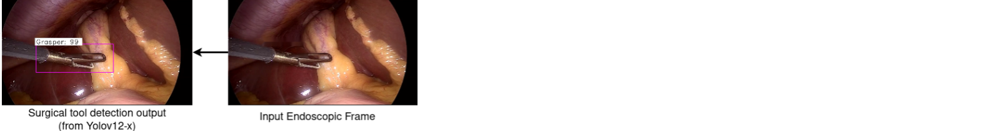
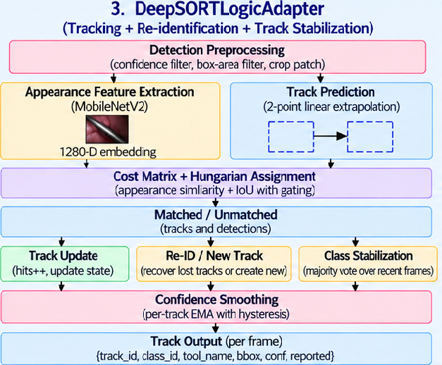
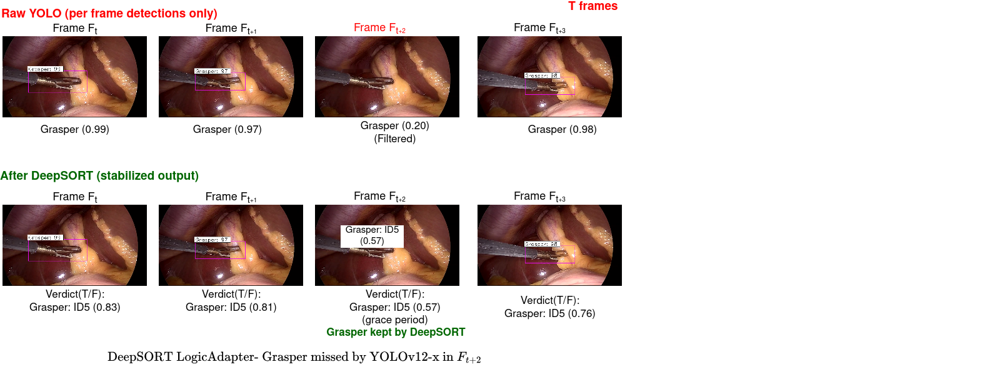

# Surgical-Assistant
## System Overview

This system provides real-time formal safety monitoring for laparoscopic cholecystectomy procedures. It processes endoscopic video frames through a four-stage pipeline that detects surgical tools, tracks them persistently across frames, preprocesses the tracking signals, and verifies them against formal safety constraints.

### Pipeline

**Video Frame → Tool Detection → Tracking & Re-ID → Signal Preprocessing → Formal Runtime Monitor → Safe / Violation**

---

### 1. Surgical Video Input and Tool Detection

The system processes sequential endoscopic video frames using a YOLOv12-x detector. For each frame, the detector identifies surgical instruments, estimates their spatial locations, and outputs the tool class, bounding box, and confidence score. The resulting detections form the input to the tracking stage.

  

### 2 DeepSORT Tracking Module

YOLOv12-X processes each video frame independently and does not maintain persistent identities for detected surgical tools. Moreover, missed detections can incorrectly indicate tool absence and potentially trigger false safety violations. To address these limitations, the DeepSORTLogicAdapter associates detections across consecutive frames, maintains persistent tool trajectories, and handles short-term detection gaps.

The tracking pipeline consists of the following components:

- **Detection Preprocessing:** Filters YOLOv12-X detections based on confidence and bounding-box criteria.
- **Appearance Representation:** Extracts normalized 1280-dimensional appearance embeddings using a pretrained MobileNetV2 feature extractor.
- **Motion Prediction:** Estimates the expected positions of tracked tools using two-point linear extrapolation.
- **Data Association:** Combines cosine appearance distance and bounding-box Intersection over Union (IoU) to construct a hybrid association cost. Hungarian assignment determines the detection-to-track correspondences.
- **Track Management:** Updates matched tracks and initializes new tracks for unmatched detections.
- **Re-identification:** Recovers previously lost tracks using tool-class consistency and appearance similarity, while removing tracks that exceed the configured age limit.

#### EMA-Based Confidence Smoothing

The DeepSORTLogicAdapter applies Exponential Moving Average (EMA)-based smoothing with hysteresis thresholds to stabilize tool-presence predictions. When a track's EMA confidence exceeds the upper threshold, its reported state becomes True, indicating reliable tool presence. If the tool temporarily disappears for a few frames but the EMA confidence remains above the lower threshold, the reported state stays True — preventing brief occlusions from triggering false tool-absence signals. The reported state is cleared only when the EMA confidence falls below the lower threshold.

The resulting tracking output for each active track contains the track ID, tool class, tool name, bounding box, confidence score, and smoothed reported state. These outputs are passed to the subsequent post-tracking preprocessing stage before formal runtime safety verification.

**Example:**### 
The following table illustrates how EMA confidence, presence and absence counts, and hysteresis conditions determine the reported tool-presence state across consecutive frames.

| Frame | Conf. | EMA | Presence Count | Absent Count | Cur State | Condition | Reported |
|---:|---:|---:|---:|---:|:---:|---|:---:|
| 1 | 0.00 | 0.00 | 0 | 1 | F | EMA < 0.5, presence < 1 | F |
| 2 | 0.85 | 0.34 | 1 | 0 | F | Presence ≥ 1 | T |
| 3 | 0.88 | 0.56 | 2 | 0 | T | Absent ≤ 2, EMA ≥ 0.35 | T |
| 4 | 0.90 | 0.69 | 3 | 0 | T | Absent ≤ 2, EMA ≥ 0.35 | T |
| 5 | 0.87 | 0.76 | 4 | 0 | T | Same | T |
| 6 | 0.85 | 0.80 | 5 | 0 | T | Same | T |
| 7 | 0.86 | 0.82 | 6 | 0 | T | Same | T |
| 8 | 0.88 | 0.85 | 7 | 0 | T | Same | T |
| 9 | 0.85 | 0.85 | 8 | 0 | T | Same | T |
| 10 | 0.87 | 0.86 | 9 | 0 | T | Same | T |
| 11 | 0.90 | 0.87 | 10 | 0 | T | Same | T |
| 12 | 0.86 | 0.87 | 11 | 0 | T | Same | T |
| 13 | 0.88 | 0.87 | 12 | 0 | T | Same | T |
| 14 | 0.00 | 0.52 | 0 | 1 | T | Absent = 1 ≤ 2, EMA = 0.52 ≥ 0.35; grace period | T |
| 15 | 0.00 | 0.31 | 0 | 2 | T | Absent = 2 ≤ 2, but EMA = 0.31 < 0.35 | F |
| 16 | 0.00 | 0.19 | 0 | 3 | F | Absent = 3 > 2, EMA < 0.35 | F |

DeepSORT output: [F, T, T, T, T, T, T, T, T, T, T, T, T, T, F, F]

**Interpretation:** The tool is initially reported as absent. After detection, its presence is established and remains stable while confidence is high. During temporary occlusion (Frames 14–16), the EMA confidence decreases. At Frame 14, the reported state remains `T` because the EMA is above the lower threshold. At Frame 15, the EMA falls below 0.35, causing the reported state to become `F`. By Frame 16, the absence count also exceeds the allowed limit of two frames.

## DeepSORT Architecture and Tracking

<table>
  <tr>
    <td align="center" width="40%">
      
       
      <b>DeepSORT Architecture</b>
    </td>
    <td align="center" width="60%">
      
       
     
    
  </tr>
</table>

### 3. Post-Tracking Signal Preprocessing

Since multiple tracks may represent the same physical tool over time, the per-track reported flags are aggregated at the tool-class level — a class is marked active if any of its tracks is reported. The resulting binary signals are smoothed over a sliding window, and a class is passed to the formal monitor as active only when its active-frame fraction meets the class-specific threshold. This step reduces transient fluctuations and provides consistent binary tool-presence signals.

**Example:** 

**Illustrative example:** The following example independently demonstrates the effect of class-specific thresholds for Bipolar and Irrigator. It illustrates how the same class-level activity pattern can produce different outputs depending on the threshold applied; it is separate from the Grasper track-aggregation example in Step 1.

A 12-frame sliding window is applied to the class-level presence sequence to reduce the effect of temporary detection gaps. For each frame, the active-frame fraction is calculated as the number of active frames (`T`) divided by the window size (12). Class-specific thresholds are applied: 0.6 for Bipolar and 0.9 for Irrigator.

#### Step 1: Track-Level Aggregation Using Logical OR

Multiple tracks may correspond to the same surgical tool class. To obtain a single class-level presence signal, the reported states of all tracks belonging to that class are combined using logical OR. The class is considered present if at least one associated track reports `T`.

**Example: Grasper tracks combined using logical OR**

| Frame | Track 5 (Grasper) | Track 9 (Grasper) | Class-Level OR |
|---:|:---:|:---:|:---:|
| 1 | F | F | **F** |
| 2 | T | F | **T** |
| 3 | T | F | **T** |
| 4 | T | F | **T** |
| 5 | F | T | **T** |
| 6 | F | T | **T** |
| 7 | T | T | **T** |
| 8 | T | T | **T** |
| 9 | T | F | **T** |
| 10 | T | F | **T** |
| 11 | T | T | **T** |
| 12 | T | T | **T** |
| 13 | T | T | **T** |
| 14 | T | F | **T** |
| 15 | F | F | **F** |
| 16 | F | F | **F** |

The resulting class-level presence sequence is:

`[F, T, T, T, T, T, T, T, T, T, T, T, T, T, F, F]`

#### Step 2: Sliding-Window Temporal Smoothing

A 12-frame sliding window is applied to the class-level presence sequence to reduce the effect of temporary detection gaps. For each frame, the active-frame fraction is calculated as the number of active frames (`T`) divided by the window size (12). Class-specific thresholds are then applied: 0.6 for Bipolar and 0.9 for Irrigator.

| Frame | Window (last 12 frames) | Active Frames | Fraction | Bipolar (≥ 0.6) |
|---:|---|:---:|---:|:---:|:---:|
| 12 | F,T,T,T,T,T,T,T,T,T,T,T | 11/12 | 0.917 | **1** |
| 13 | T,T,T,T,T,T,T,T,T,T,T,T | 12/12 | 1.000 | **1** | 
| 14 | T,T,T,T,T,T,T,T,T,T,T,T | 12/12 | 1.000 | **1** | 
| 15 | T,T,T,T,T,T,T,T,T,T,T,F | 11/12 | 0.917 | **1** | 
| 16 | T,T,T,T,T,T,T,T,T,T,F,F | 10/12 | 0.833 | **1** | 

#### Key Observation: Frame 16

At Frame 16, the sliding window contains 10 active frames and two inactive frames, giving an active-frame fraction of \(10/12 \approx 0.833\).

- **Bipolar:** \(0.833 > 0.6\), so the output remains active (\(T_2 = 1\)). The temporary absence is tolerated.
- **Irrigator:** \(0.833 < 0.9\), so the output becomes inactive (\(T_7 = 0\)). The stricter threshold rejects the same active-frame fraction.

The resulting class-level Boolean signals, \(T_2\) and \(T_7\), are passed to the formal runtime monitor for verification of surgical tool usage sequences and temporal constraints.

The resulting Boolean signals are then passed to the formal runtime monitor for verification of surgical tool usage sequences and temporal constraints.

### 4. Formal Runtime Monitoring

An offline process extracts safety rules in Signal Temporal Logic (STL) from expert surgical recordings, complemented by clinical guidelines manually formalized by expert surgeons. These rules specify safety constraints such as permitted tool-use sequences and duration limits.

The resulting rules are used to synthesize a runtime monitor deployed after the signal preprocessor. It checks incoming binary tool-presence signals against the safety constraints and reports either a **safe state** or a **violation**, which is recorded with the corresponding frame for further analysis.

